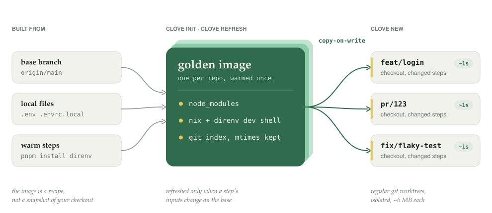

<picture>
  <source media="(prefers-color-scheme: dark)" srcset="brand/mark-on-dark.svg">
  
</picture>

# clove

[](https://github.com/pierre-borckmans/clove/actions/workflows/ci.yml)
[](https://github.com/pierre-borckmans/clove/releases/latest)
[](LICENSE)

A ready git worktree in ~1s, with `node_modules`, the dev shell and every other ignored file already there.

```
$ clove new feat/login
+ feat/login
  ✓ clone image              0.00s
  ✓ mount                    0.70s
  ✓ checkout                 0.21s
  ✓ setup mise-trust         0.02s
  ✓ setup direnv-allow       0.02s
  · setup direnv             unchanged since golden
  · setup pnpm               unchanged since golden

● feat-login ready in 1.0s ~/src/mono.clove/feat-login/mono
```

| On a ~35k-file monorepo | `git worktree add` + setup | `clove new` |
|---|---|---|
| Time to a usable checkout | ~70s | ~1s |
| New disk per worktree | a few GB | ~6 MB |

## Install

The CLI and terminal UI, on macOS and Linux:

```
brew install pierre-borckmans/tap/clove
clove shell-init --install       # cd into new clones, completions (zsh, bash, fish)
```

The desktop app, on macOS, with a menu-bar popover:

```
brew install --cask pierre-borckmans/tap/clove-app
```

On Linux (x86_64 and arm64), a `.deb` and an AppImage are on the [releases page](https://github.com/pierre-borckmans/clove/releases). It runs the CLI for the background service, so install that too.

```
sudo apt install ./clove-app-v<version>-x86_64.deb    # Debian, Ubuntu
chmod +x clove-app-v<version>-x86_64.AppImage         # anywhere else; needs libfuse2
```

Without Homebrew:

- **Prebuilt binaries** for macOS and Linux are on the [releases page](https://github.com/pierre-borckmans/clove/releases). The macOS ones are signed and notarized.
- **From source:** `cargo install --git https://github.com/pierre-borckmans/clove clove-cli`

Then, in a repository:

```
clove init                       # shows what it will set up, then builds the golden image (once)
clove new feat/login             # a ready worktree on that branch
clove service install            # remount clones at login, keep golden images fresh
clove agents install             # teach Claude Code, Codex, OpenCode V2 and Pi to use clove (optional)
```

<details>
<summary><strong>Requirements</strong></summary>

#### macOS

- APFS, the default filesystem.
- Tested on macOS 26, which has ASIF disk images.
- Older versions fall back to `hdiutil` sparse images: implemented, but untested.

#### Linux

- `btrfs-progs` (`sudo apt install btrfs-progs`) and loop devices. The host disk can be any filesystem.
- Kernel 6.7+ gives exact clone sizes (simple quotas). Older kernels use full qgroups, or report no sizes.
- `clove init` offers to add one line to `/etc/fstab`, with sudo, once per repo:

  ```
  ~/.clove/repos/<repo>-<hash>/pool.btrfs ~/src/<repo>.clove btrfs loop,user,noauto,exec,user_subvol_rm_allowed 0 0
  ```

- How clove mounts the repo's image, in order of preference (`clove doctor` says which one a repo uses):
  - **With that fstab line:** as you, at `<repo>.clove`, from a desktop or over SSH.
  - **Without it, through udisks2** if installed: only from a desktop session, with clones under `/run/media/$USER/` (or `/media/$USER/`).
  - **`sudo -n`** as a last resort.

</details>

## Why

- **`git worktree add` gives you the tracked files and nothing else.** On a monorepo with ~35k files, ~4.5k npm packages and a nix flake dev shell, a fresh worktree takes ~70s before anything runs:
  - ~40s for direnv to evaluate the flake
  - ~30s for `pnpm install --offline`
  - a few GB of new files
- **Copying the ignored files over doesn't scale with file count.** Tools like worktrunk's `copy-ignored`, `cp -c` and the git-cow family copy-on-write file by file. That saves disk, but time grows with the number of files: that repo's ~550k ignored files take minutes, and `clonefile` on the root `node_modules` alone takes ~15s.
- **clove copies one disk image instead of half a million files**, so the cost doesn't depend on how many files the repo has.

## How it works

<picture>
  <source media="(prefers-color-scheme: dark)" srcset="brand/how-it-works-dark.svg">
  
</picture>

- **One golden image per repo:** a worktree of the base branch, with dependencies installed and dev environments warmed.
- **A clone is a copy-on-write copy of it**, registered as a regular git worktree with a copy of the golden index. Inodes and timestamps are kept, so git rehashes nothing.
- **Then only what changed runs:** clove checks out your branch and reruns the setup steps whose inputs changed since the golden commit. Same lockfile, no `pnpm install`.
- **Clones are isolated.** Adding a dependency or editing the nix flake in one doesn't affect the others.
- **Normal tools work inside a clone:** file watchers, Docker bind mounts, Go and Rust builds.

<details>
<summary><strong>Under the hood on macOS and Linux</strong></summary>

#### macOS

The golden image is an APFS volume in a disk image file. `clove new`:

1. copies the image *file* with `clonefile(2)`: one syscall whatever is inside, and no disk used until something is written
2. mounts the copy as its own volume (~0.7s)
3. registers the worktree and runs the changed steps

On the monorepo above: ~1.1s and ~6 MB of disk per clone. `clove init` took ~1m20s, once.

#### Linux

- Each repo has one btrfs image file, mounted once.
- The golden worktree is a subvolume in it, and a clone is a snapshot of that subvolume, so there's no mount per clone.
- On a ~185k-file golden: the snapshot takes ~8 ms, and the first `git status` in the clone ~50 ms, with no rehash.

More in [internals](docs/internals.md).

</details>

## Features

- **Any branch or PR, ready in ~1s.** `clove new feat/x`, `clove new pr:123`, or `-x claude` to start an agent in it. → [Commands](docs/commands.md)
- **CLI, terminal UI and desktop app** (macOS and Linux), with the same features everywhere; every command takes `--json`. → [Interfaces](docs/commands.md#interfaces)
- **Shell integration:** `cd` into new clones, completions, and each clone's environment loaded while you're in it. → [Shell integration](docs/commands.md#shell-integration)
- **Brings clones up to date:** `clove update` rebases onto the latest base and reruns only the setup steps that changed; conflicts stop cleanly, with `--continue` or `--abort`. → [Updating a clone](docs/commands.md#updating-a-clone)
- **Works next to plain git worktrees:** lists them, removes them safely, or adopts them as clones. → [Plain git worktrees](docs/commands.md#plain-git-worktrees)
- **Cleans up after merged PRs,** squash merges included, by hand or automatically, with a history to get any branch back. → [Cleaning up](docs/cleanup.md)
- **Built for coding agents:** one command teaches Claude Code, Codex, OpenCode V2 and Pi to use clones. Claude Code and OpenCode V2 use clones for native worktrees in repos clove manages. → [Coding agents](docs/agents.md)
- **Stays fresh on its own:** incremental refreshes, only when a step's inputs change on the base. → [Staying fresh](docs/freshness.md)
- **Detects your toolchain:** mise, direnv + nix, cargo, uv, pnpm, bun, yarn, npm, plus your own steps and local files like `.env`. → [Configuration](docs/configuration.md)

Also: [limits](docs/limits.md) and [internals](docs/internals.md) (how clones are stored on macOS and Linux).

## Develop

```
cargo test --workspace           # unit tests + an end-to-end run on real disk images (macOS)
scripts/smoke.zsh                # the CLI through the zsh integration, on a throwaway repo
```

Releasing and signing: [RELEASING.md](RELEASING.md).

MIT licensed.
